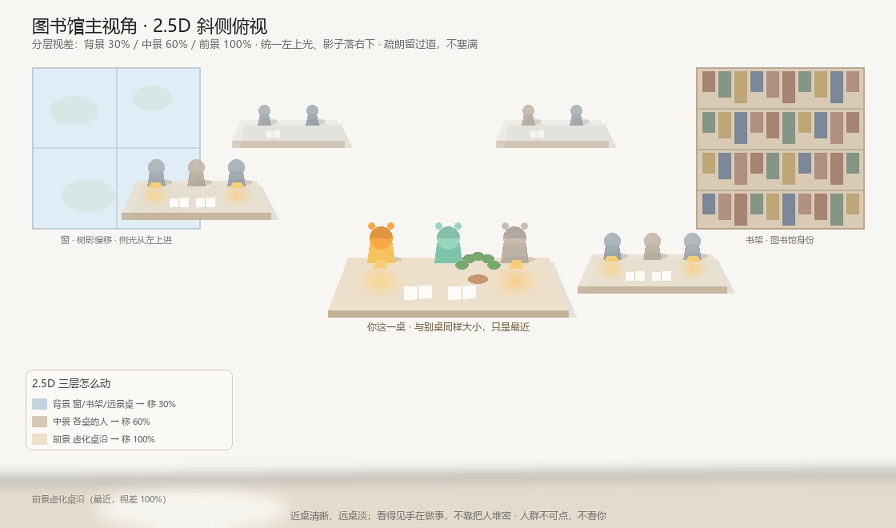

# 小熊镇自习室 · 场景与体验设计（定稿）

**定位**：把番茄钟包成游戏的熊版自习室。用现成的熊 IP 和 2D 素材，做建档、换装、镜头调度下的专注、结算、解锁五个阶段，不做真人联机。

**三种感觉**：画面好看、游戏化反馈、一屋子人在学。进场建档游戏化最强，专注时画面和人群撑场，结尾结算领奖。

---

## 一、场景设计

**屋子**：长桌排开、桌桌有人，全屋 20 人以上。窗在左、书架在右，光从左上进。你和小林并排坐其中一张桌，对面也坐着人。你只是屋里的一员，小林是你的同桌。



*主视角效果；第二节有俯视图看布局。你那桌和别桌一样大，只用颜色区分，不居中、不追光。*

**人群**：所有桌子的人都看得见在做事（写字、翻页、敲键盘），近桌稍清晰、远桌稍淡。不可点、不说话、不看镜头。不显示在线人数。

**三个场景**（第一版只做 A；B 复用 A 的桌面层只换背景；C 最后做）：

| 场景 | 一句话 | 情绪 | 优先级 | 现有底图 |
|---|---|---|---|---|
| A 树影图书馆 | 一屋子长桌坐满人，你和小林是其中一桌 | 安静、在人群中 | 必做 | `树影图书馆.png` |
| B 暖邻小书房 | 安静小书房，窗外会变天 | 柔和、治愈 | 第二 | `暖邻康护院.png` 改色 |
| C 慢生活咖啡角 | 靠窗咖啡桌，背景零星人影 | 轻松、有一点人气 | 可选 | `慢生活园.png` 改色 |

**B 的设定**：同桌不是伴侣、不是二人世界。"私密"指不被真人看见、不用社交；治愈感来自光和安静。B 是唯一允许"只有你们俩"的场景，A 和 C 都保持一屋子人。

**画面**：2.5D，把 2D 素材分层错动，不建模。前后多排桌子形成纵深。

---

## 二、场景细节


**桌子**：1800×750mm 长桌，排 3 排、每排约 3 张，桌间留过道；每桌 2–4 人。你那桌在中间偏前，不居中、不放大。你和小林并排坐远侧，中间 30cm 摆 45cm 绿萝，对面坐一位读者。
- 每人桌面宽 900mm、深 750mm，桌高 750mm，摊开的书按 450–500mm。
- 斜侧 45° 机位，桌面占画面下半，窗在左、书架在右，镜头固定不抖动。

**桌面道具**：每人一套三区，对称但不镜像——正前方放正在做的事（你的笔记本 / 它的厚书），惯用手侧放手边物（水杯），非惯用手侧放私人物（便签、橡皮），台灯放桌角外侧。
- **A**：长桌、两盏台灯、厚书加笔、浅杯、橡皮、笔记本笔袋水杯、目标便签、绿萝、大窗加树影、书架、各桌读者、尘埃颗粒。
- **B 再加**：落地灯、窗边绿植、干花、地毯、小玩偶、休息时玩手机的手、会变的天气。
- **C**：小圆桌两椅、拉花咖啡、窗外街景、菜单立牌、零星人影、吊灯。

**每天的变化**：桌面有一处不同——厚书换笔记本、玻璃杯换保温杯、偶尔多一块薄荷糖或折起的纸条。

**2.5D 分层**：视差前景 100%、中景 60%、背景 30%。远景（墙窗书架 + 后排桌）→ 中景（各桌的人、灯）→ 桌面（道具、目标牌、计时器）→ 前景（虚化桌沿）。手机视差改缓慢自动飘动。补图统一斜侧角度，每个物件有自己的影子。

| 时段 | 窗外 | 主光 | 台灯 |
|---|---|---|---|
| 白天 | 亮，树影慢移，偶尔云遮 | 冷白侧光 | 关或很弱 |
| 傍晚 | 暖橘，光下沉 | 暖橘侧光 | 小林先拧亮自己的灯 |
| 夜晚 | 全黑，远处余光 | 无 | 各桌台灯照出一片片暖光池 |

光是同一片，落在所有桌上；连续渐变，跟随真实时间并给手动三档。

**美术清单**：

| 类别 | 现有可用 | 需补 |
|---|---|---|
| 角色 | 小林 5 表情、小赵等 5 只熊、纸娃娃图集 | 坐姿身体底图、头手分层、手部动作（写字、翻页） |
| 场景底图 | 图书馆、康护院、慢生活园等大图 | 平视书桌背景 1 张 |
| 桌面物件 | 无 | 书、杯、笔、台灯、绿萝、橡皮、便签约 10 件，透明 PNG 复用三场景 |
| 人群 | 无 | 一套通用坐姿读者图（3–4 姿势循环，多桌复用） |
| 氛围层 | 无 | 尘埃、颗粒、光晕、窗外天气，程序做不用画 |
| UI | ui/ 底板 | 目标牌、计时器、结算卡、陪伴强度选择 |

---

## 三、交互逻辑

**一次自习**：
- **入场**：写明信片（1–5 年目标 100 字内 + 今天三件小事，贴桌面右上角），选陪伴强度（安静 / 正常 / 主动，默认中间），坐下。
- **专注**：四机位每分钟自动切；偶尔翻书、喝水的轻响，小林埋头不看你。
- **休息**：叮，小林合书侧头，沙沙声停；可说话、看窗外、写便签；末尾它摊书说"我继续咯"，沙沙声回来。
- **结算**：结算卡——今日 45 分钟、比上次多 10 分钟、45 勺蜂蜜、连续 6 天，小林"我也刚做完一套"。只跟自己比，评语只说它自己。
- **成长**：蜂蜜换装扮、场景解锁（连续 3 天小书房、累计 10 小时咖啡角）、座位牌边框进化；未解锁显示灰色预览卡。1 分钟 = 1 勺蜂蜜。

**镜头调度**（横屏、每分钟自动切、0.6 秒缓慢推拉，右上角 AUTO / 固定开关）：

| 机位 | 拍什么 | 占比 |
|---|---|---|
| 图书馆全景 | 整间屋子，多排长桌、满屋子人在学 | 45% |
| 你这一桌 | 你 + 小林 + 对面读者 | 25% |
| 小林特写 | 它的脸和正在动的手 | 15% |
| 邻桌 | 旁边桌的读者在写字、翻页 | 15% |

| 状态 | 小林的视线 | 能点什么 |
|---|---|---|
| 专注中 | 99% 不看你 | 开始 / 暂停 / 结束、目标牌（进入时）、台灯；戳它回"先专心，回头说" |
| 休息中 | 合书，慢慢转向你 | 解锁全部：戳它、写便签、点物件、看窗外 |
| 刚进入 | 已在座位，不看你 | 写目标牌、选陪伴强度、选时段 |

其他桌的人不可点。第一版做 A 里 4 个交互点：目标牌、台灯、计时、戳小林。B 的"学不进去"情绪响应（不催学，灯光变柔、雨声变缓、"今天我们都辛苦啦"）放第二版。

**声音**：底层固定下雨声（雨点打窗玻璃）；中层沙沙、纸响、杯"嗒"，稀疏；顶层无配音、极少碎念。专注结束叮一声、沙沙停；休息结束敲书"我继续咯"、沙沙回来。第一版只做底层雨声 + 叮。

---

## 四、NPC 互动与设计

小林是唯一可互动的同桌，和其他桌的人一样大、一样在做事，不特殊化。核心是那双会动的手，表情只是点缀。

**动作池**：
- **自主**：低头写字（占绝大多数时间）、翻书抚平、端杯轻放；捏眉心、发呆、拢头发、目光飘窗外。随机，间隔 1–5 分钟，缓慢幅度小。
- **反应**：坐下 → 抬头点头再低头；暂停 → 疑惑 / 无奈脸；达标 → 开心挥手；戳它 → 说一句又低头；连着来 → 话变多更放松；几天没来 → "我以为你不来了"。

**视线**：专注期 99% 不看你；只有你主动搭话、或休息合书时才转头看你。它也会学累：动作变慢、发呆变多、久托腮。

**熟悉度**：三阶段——头几次礼貌话少 → 熟了摸鱼聊自己考试 → 再熟紧张吐槽、记得你习惯。

**关系设定**：同桌，不是伴侣、不是安慰你的 AI。台词只说自己的小事；不并肩太近、不对视微笑、不纪念日、不昵称互称；情绪响应是"同处一室的人都累了"的体谅。

**分层立绘**：身体底图 1 张；头部 = 现有 5 表情裁头 + 补低头 / 侧头 / 后仰困 / 趴下 4 张；手部 = 扶书 / 写字 / 端杯 / 翻页 4 张；眼睛 = CSS 盖或闭眼图 1 张。同一套图复用到各桌读者。第一版先做写字 + 翻页。

**小细节**（只在休息触发）：便签（可回一张，下次还在）、天气联动、疲劳共鸣（"今天我们都辛苦啦"）、物品微变化。默认主动台词关闭。

---

## 五、NPC 记忆系统

**存什么**（localStorage，跨天累积、不重置）：

```
{
  目标文本, 陪伴强度,
  小林状态值：{精力, 专注, 心情, 紧张度},
  熟悉度：1-3,
  记录：[{日期, 时长}],
  座位保留天数, 请假券剩余
}
```

**状态值**：你专注 → 专注值涨；你离开 → 松一点；考试临近 → 紧张度涨（有上限、有收尾）。座位保留 + 请假券：连续来留座，请假用券，不因断一天清零。

**台词**：预写规则池，按"状态 × 熟悉度 × 陪伴强度"三重筛选——强度定话量，熟悉度定亲疏，状态值定口吻，5–8 句一轮换。

**边界**：小林是规则驱动的 NPC，不是 AI，不接大模型、不上传数据。效果口径：更容易坐下来、更愿意回来；不宣称成绩提升。

---

## 写在最后

- **边界**：纯前端（Vite + React + TypeScript + localStorage），不接后端、不联机；人群是氛围不是真人；不做 3D、高斯泼溅。
- **落地顺序**：补图 → 一屋子桌子的静态版 → 分层动作 + 状态记忆 → 计时打卡结算解锁。
