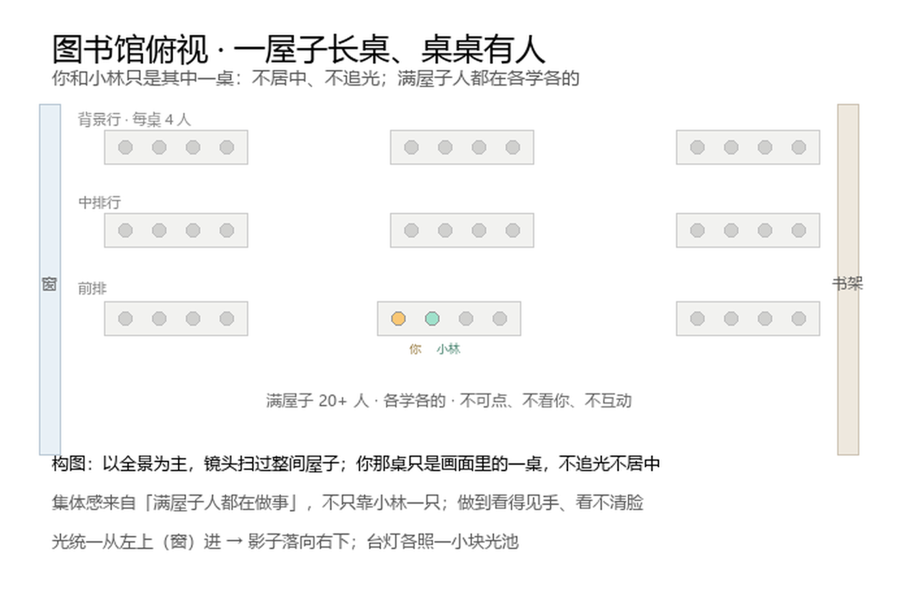

# 小熊镇自习室 · 场景与体验设计（定稿）

**一句话：把番茄钟包成游戏。** 借 FocusTown 的镜头调度、目标锚定、结算仪式、成长解锁，用现成的熊 IP 和 2D 素材演出来，不做真人联机。

**自习室的感觉**：一屋子长桌、桌桌有人在学，你和小林只是其中一桌。不是两个人的特写，是"很多人在安静地各学各的"。三种感觉分时上——进场游戏化最强，专注时画面感和人群感一起撑场，结尾结算领奖。

---

## 一、场景设计

**本章重点：主角是整间屋子，不是你和小林两人。**

**屋子**：一张张长桌排开，桌桌坐 4 人左右，全屋 20 人以上，各学各的；窗在左、书架在右，光从左上进来。你和小林并排坐其中一张桌，对面也坐着人（不可点、不看你）。你只是这满屋子人里的一个，小林是你的同桌，不是全场唯一的角色。


*上图是主视角效果；第二节还有一张俯视图看布局——你那桌和别桌一样大，只用颜色区分，不居中、不追光。*

**人群均匀铺开，不搞"主角桌 + 背景虚影"**：所有桌子的人和你在同一层空间里，都看得见在做事（写字、翻页、敲键盘）；近处的稍清晰、远处稍淡，但没有"只有你俩是清晰的、其余是糊的"这种割裂。Density 靠桌数，不靠把一个主桌做大。

**集体感来自"一屋子人都在做事"**：这比只让小林一只熊在写更有说服力——满桌的人低头用功，才是图书馆。小林仍是可互动的那个，但它不特殊化、不追光、不居中。

**诚实口径**：人群是氛围不是真人，不显示"当前在线 N 人"这种假数字；可信数字只有你自己的：今天第几次坐下、连续第几天。

**三个场景**（第一版只做 A；B 复用 A 的桌面层只换背景；C 等前两个跑通）：

| 场景 | 一句话 | 情绪 | 优先级 | 现有底图 |
|---|---|---|---|---|
| A 树影图书馆 | 一屋子长桌都坐满人，你和小林是其中一桌 | 安静、有距离感、在人群中 | 必做 | `树影图书馆.png` |
| B 暖邻小书房 | 安静小书房，窗外会变天，小林恰好也在这自习 | 柔和、治愈 | 第二 | `暖邻康护院.png` 改色 |
| C 慢生活咖啡角 | 靠窗咖啡桌，背景零星人影 | 轻松、有一点人气 | 可选 | `慢生活园.png` 改色 |

**B 的红线：是同桌，不是伴侣、不是二人世界。** "私密"指不被真人看见、不用社交、没有围观压力（照顾社恐）；治愈感来自光和安静，不来自亲密关系。**注意 B 是唯一允许"只有你们俩"的场景**，A 和 C 都保持一屋子人。

**2.5D**：不是 3D 建模，是把现成 2D 素材分层错动。关键是补上一张对的画面：**平视的书桌 + 坐着的人 + 手边的书**，且要画出前后多排桌子，才有图书馆的纵深。

---

## 二、场景细节

**本章重点：画一屋子桌子，你那桌和别人桌一样大、一样清楚。**



**整间屋子**：长桌 1800×750mm，排 3 排、每排 3 张左右，桌间留过道；每桌 2–4 人，全屋 20 人以上。你那桌在中间偏前的普通位置，不居中、不放大。所有桌都看得见在做事，靠远近和明暗拉开层次，不靠"把别人糊掉"。

**你那桌**：你和小林并排坐远侧，中间 30cm 摆 45cm 绿萝；对面坐着一个读者（不可点、不看你）。
- **并排不面对面**：面对面有对抗感；有挡板时人更愿并排。
- **绿萝 45cm**：30cm 挡不住对视，45–50cm 刚好，超 60cm 变格子间。
- **尺寸**：每人桌面宽 900mm（低于 750 会互相压到）、深 750mm、桌高 750mm，摊开的书 450–500mm。
- **构图**：全景为主，镜头扫过整间屋子；窗在左（主光源）、书架在右；斜侧 45° 机位；**镜头固定不抖动**。

**人群规则**：每张桌的人循环做写字、翻页、敲键盘、起身走动；不可点、不说话、不看你。近桌清晰、远桌稍淡，但都保持"正在做事"的可读性——看不清脸，但看得见手在动。

**桌面道具**：每人一套三区，**对称但不镜像**——正前方放正在做的事（你的笔记本 / 它的厚书），惯用手侧放手边物（水杯），非惯用手侧放私人物（便签、橡皮），台灯放桌角外侧避开反光。留"住过的痕迹"：你带水杯它带保温杯，橡皮歪着、书页折角、杯子有喝过的水位；每天进来桌面有一处不同（厚书换笔记本、偶尔多一块薄荷糖）。
- **A**：长桌、两盏台灯、厚书加笔、浅杯、橡皮、笔记本笔袋水杯、目标便签、绿萝、大窗加树影（**给时间流动和尺度**）、书架、各桌读者、尘埃颗粒。
- **B 再加**：落地灯、窗边绿植、干花、地毯、小玩偶（私人物件）、休息时玩手机的手、会变的天气。
- **C**：小圆桌两椅、拉花咖啡、窗外街景、菜单立牌、零星人影、吊灯。

**2.5D 分层**：视差前景 100%、中景 60%、背景 30%。远景（墙窗书架 + 后排桌）→ 中景（各桌的人、灯）→ 桌面（道具、目标牌、计时器）→ 前景（虚化桌沿，做很淡）。手机视差改缓慢自动飘动。**两条红线：补图统一斜侧角度；每个物件要有自己的影子。**

| 时段 | 窗外 | 主光 | 台灯 |
|---|---|---|---|
| 白天 | 亮，树影慢移，偶尔云遮 | 冷白侧光 | 关或很弱 |
| 傍晚 | 暖橘，光下沉 | 暖橘侧光 | 小林先拧亮自己的灯 |
| 夜晚 | 全黑，远处余光 | 无 | 各桌台灯照出一片片暖光池 |

**光是同一片，落在所有桌上**——这是"共处一室"最直观的暗示。脸留在阴影里、手和书留在灯下；光连续渐变、跟随真实时间 + 手动三档，有光必有影。

| 类别 | 现有可用 | 需补 |
|---|---|---|
| 角色 | 小林 5 表情、小赵等 5 只熊、纸娃娃图集 | 坐姿身体底图、头手分层、手部动作（写字、翻页） |
| 场景底图 | 图书馆、康护院、慢生活园等大图 | 平视书桌背景 1 张（俯视不能用，**"像不像自习"的关键一张**） |
| 桌面物件 | 无 | 书、杯、笔、台灯、绿萝、橡皮、便签约 10 件，透明 PNG 复用三场景 |
| 人群 | 无 | 一套通用坐姿读者图（3–4 姿势循环，多桌复用），看得见手在做事 |
| 氛围层 | 无 | 尘埃、颗粒、光晕、窗外天气，程序做不用画 |
| UI | ui/ 底板 | 目标牌、计时器、结算卡、陪伴强度选择 |

**现有美术撑得起角色和氛围底图，撑不起"平视桌面 + 会动的手"**——后者是核心，补图是开工前置。人群用一套图多桌复用，成本可控。

---

## 三、交互逻辑

**本章重点：镜头以整间屋子为主，你那桌只占一部分时间。**

- **入场**：写明信片（1–5 年目标 100 字内 + 今天三件小事，贴桌面右上角），选陪伴强度（安静 / 正常 / 主动，默认中间），坐下。
- **专注**：四机位每分钟自动切，大部分时间看整间屋子和各桌的人；偶尔翻书、喝水的轻响，小林埋着头不看你、几乎不说话。
- **休息**：叮，小林合书侧头，沙沙声停；可说话、看窗外、写便签；末尾它摊书说"我继续咯"，沙沙声回来。
- **结算**：四五秒结算卡——今日 45 分钟、比上次多 10 分钟、45 勺蜂蜜、连续 6 天，小林"我也刚做完一套"。**只跟自己比不排名；评语只说它自己；有仪式感但不吵。**
- **成长**：蜂蜜换装扮、场景解锁（连续 3 天小书房、累计 10 小时咖啡角）、座位牌边框进化；未解锁显示灰色预览卡。**1 分钟 = 1 勺蜂蜜。**

**镜头调度**（横屏、每分钟自动切、0.6 秒缓慢推拉不硬切，右上角 AUTO / 固定开关）：

| 机位 | 拍什么 | 占比 |
|---|---|---|
| 图书馆全景 | 整间屋子，多排长桌、满屋子人在学 | 45% |
| 你这一桌 | 你 + 小林 + 对面读者 | 25% |
| 小林特写 | 它的脸和正在动的手 | 15% |
| 邻桌 | 旁边桌的读者在写字、翻页 | 15% |

**全景是默认主角镜头**，特写是点缀——不让画面长期停在一张脸上。

| 状态 | 小林的视线 | 能点什么 |
|---|---|---|
| 专注中 | 99% 不看你 | 开始 / 暂停 / 结束、目标牌（进入时）、台灯；戳它回"先专心，回头说" |
| 休息中 | 合书，慢慢转向你 | 解锁全部：戳它、写便签、点物件、看窗外 |
| 刚进入 | 已在座位，不看你 | 写目标牌、选陪伴强度、选时段 |

**其他桌的人一律不可点**，只做背景里的生活；台灯是专注期唯一额外可点的，只影响光不影响计时。第一版做 A 里 4 个交互点就够：目标牌、台灯、计时、戳小林。B 的核心是"学不进去"时**不催学**：灯光变柔、雨声变缓、"今天我们都辛苦啦"（放第二版）。

**声音**：底层固定下雨声（雨点打窗玻璃）；中层沙沙、纸响、杯"嗒"，稀疏；顶层无配音、极少碎念。切换信号：叮 → 沙沙停；敲书"我继续咯" → 沙沙回来。第一版只做底层雨声 + 叮。

---

## 四、NPC 互动与设计

**本章重点：集体感来自满屋子人都在做事；小林是可互动的那个，但不特殊化。**

**为什么这样能减少走神（有证据，不是设计愿望）**：旁边有人认真学习，能不能让你少开小差？分两个效果看，别混为一谈——
- **能让的：坐得住、不走神、不中途放弃。** 2025 年VR实验（Ara 等，ADHD成人）里，有真人或有 AI 陪着做事，速度、准确率、持续注意都比独干好，AI 接近真人；中风康复 VR 研究（Frontiers 2025）里，虚拟伙伴让投入和坚持明显更高。机制不是"被监督"，是**看得见别人在做同一件事，触发运动共振和"这里该安静做事"的规范感**，走神的门槛就高了。
- **不能让的：学得更聪明、成绩更好。** 上面这些研究反复出现同一句——投入上升，客观成绩没有显著变化。所以对外只说"更容易坐下来、更不容易中途逃走"，不说"用了就更专注"。
- **成立的前提（做错就归零）**：VR 研究里有人直说"深度学习我更想要真人，因为 AI 不在乎"，也有人说"你可以轻易忽略它，因为它就是个电脑"。所以 NPC 必须**低头做事、手在动、不看你、有影子和台灯光**，大脑才把它当"一个在努力的同类"；一旦抬头盯你、冲你笑、频繁互动，就掉进下面"头像凝视"那档最差效果，反而分心。**结论：视线两铁律和"看得见的手"不是美术偏好，是这个效果成立的技术前提。**

**四种画面效果排序**：工作台投影（看得见手）最好 > 工作姿态不错 > 屏幕共享极端 > **头像凝视（一张脸看着你）最差**。**价值全在"正在做事的手"——这定死了必须做头 / 手分层立绘，而且这套动作要让各桌的人都有，不只小林。**

**动作池**：
- **自主**（前三类看得见手、多做）：低头写字（最核心，占绝大多数时间）、翻书抚平、端杯轻放；捏眉心、发呆、拢头发、目光飘窗外（点缀，少做）。随机、间隔 1–5 分钟、缓慢幅度小。
- **反应**：坐下 → 抬头点头再低头；暂停 → 疑惑 / 无奈脸；达标 → 开心挥手；戳它 → 说一句又低头；连着来 → 话变多更放松；几天没来 → "我以为你不来了"。

**视线两铁律**：**专注期 99% 不看你**；只有你主动搭话、或休息合书时才转头看你。它也会学累（动作变慢、发呆变多、久托腮），是它自己的状态、不为安慰你，别做太多。

**熟悉度三阶段**：头几次礼貌话少 → 熟了摸鱼聊自己考试 → 再熟紧张吐槽、记得你习惯。

**关系红线**：**是同桌，不是伴侣、不是安慰你的 AI。** 台词只说自己的小事，不用"我们俩""只有你懂我"；不并肩太近、不对视微笑、不纪念日、不昵称互称；情绪响应是"同处一室的人都累了"的体谅，不说"有我在""别怕"，只说"今天都辛苦了"；不说"AI 懂你"。

**分层立绘**：身体底图 1 张；头部 = 现有 5 表情裁头 + 补低头 / 侧头 / 后仰困 / 趴下 4 张；手部 = 扶书 / 写字 / 端杯 / 翻页 4 张；眼睛 = CSS 盖或闭眼图 1 张。换头 + 换手 + 位移拼出十几种动作。这套图同样复用到各桌读者上，一屋子人就都"活"了。第一版先做写字 + 翻页。

**小细节**（只在休息触发）：便签（可回一张，下次还在）、天气联动、疲劳共鸣（"今天我们都辛苦啦"，不打气不说教）、物品微变化（成本最低、最可信）。**默认主动台词建议关。**

---

## 五、NPC 记忆系统

**本章重点：靠一组本地数字，让小林越来越熟、记得你的习惯、你几天不来它会在意。是规则池，不是真 AI。**

**记什么**（localStorage 一个 JSON，跨天累积、不重置）：

```
{
  目标文本, 陪伴强度,
  小林状态值：{精力, 专注, 心情, 紧张度},
  熟悉度：1-3,
  记录：[{日期, 时长}],
  座位保留天数, 请假券剩余
}
```

**状态值怎么变**：你专注 → 专注值涨；你离开 → 松一点；考试临近 → 紧张度涨（**有上限、有收尾**）。台词按状态抽，5–8 句一轮换。座位保留 + 请假券 = "它一直在这等你"：连续来留座，请假用券，不因断一天清零。

**熟悉度与跨天**：1 → 3 决定三阶段；跨天痕迹是物品微变化、几天没来重逢（"我以为你不来了"，精神变好）。

**台词怎么选**：预写规则池，按"状态 × 熟悉度 × 陪伴强度"三重筛选——强度定话量（安静档几乎不说），熟悉度定亲疏，状态值定口吻。

**诚实边界**：不宣称真正理解你、有自我意识，不接大模型、不上传数据。**能证明的是"更容易坐下来、更愿意回来"，不是"用了就更专注"。**

---

## 写在最后：边界与落地顺序

- **边界**：纯前端（Vite + React + TypeScript + localStorage），不接后端、不联机；人群是氛围不是真人，不宣称在线人数；小林是 NPC 不是 AI；不做 3D、高斯泼溅。
- **落地顺序**：补图（含一套通用读者）→ 一屋子桌子的静态版，把"像图书馆"做对 → 分层动作 + 状态记忆 → 计时打卡结算解锁。
- **优先级前五**：一屋子会动的读者 + 会动的 NPC、全景为主的镜头、并排多桌加 2.5D 视差、共享光影加昼夜、专注 / 休息切换信号。
- **一句话收尾**：熊版自习室 = FocusTown 五阶段爽感机制（建档 → 换装 → 镜头调度下的专注 → 结算 → 解锁），换成现成的熊和 2D 素材来演，砍掉真人联机；三种感觉各站在该站的阶段上，主角是整间屋子。
