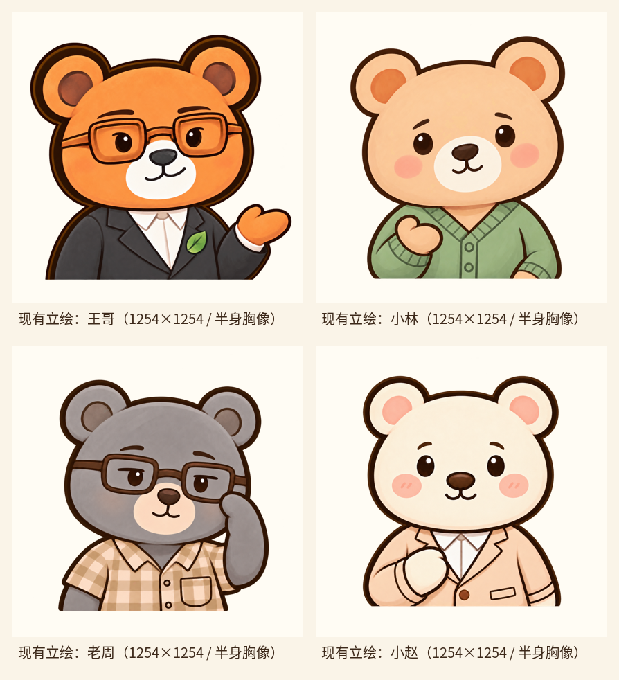
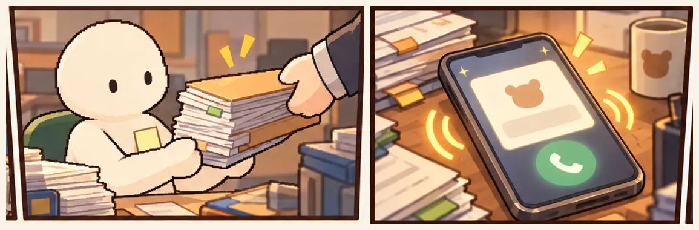
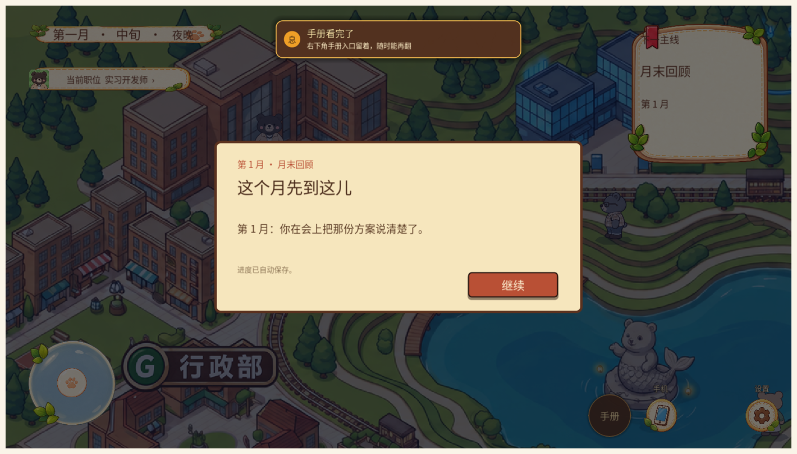
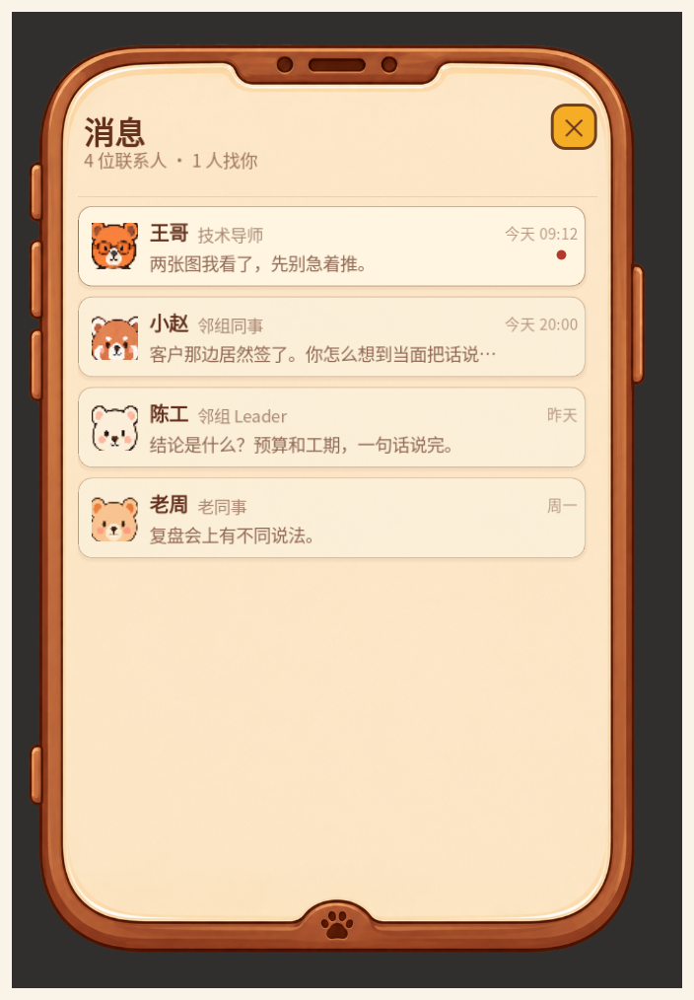

# 《熊心壮职》十二个月版 · 美术素材需求清单

**版本** V1 ｜ **日期** 2026-10-30 ｜ **对应流程** 12m_v1（第 1–12 月剧情全量）｜ **用途** 对外发单

> 一句话：八张区域场景、四位主角立绘、HUD 套件都已经齐了；现在真正缺的是“人”——陈工、方经理、许棠三位关键角色没有立绘，第 6 / 12 月答辩的评审席只有台词没有脸。其次是开场漫画要重画、报告页要一套正式底板。

---

## 一、先看结论

| 批次 | 内容 | 为什么排在这里 |
|---|---|---|
| 第 1 批（P0） | 陈工、方经理、许棠：立绘 + 头像；陈工另加 16 帧行走图 | 第 1 月第一场戏就有陈工，第 3 月客户谈合同，第 10 月新人入职；没有脸，这三段演出是空的 |
| 第 2 批（P1） | 大领导、HRBP、跨部门评委、记录评委：立绘 + 头像；产品同事、群演：头像；开场漫画 12 格；报告页 | 第 6 / 12 月答辩和结局报告是全年最重要的两场戏；开场漫画是玩家看到的第一眼 |
| 第 3 批（P2） | 月首 / 月末卡底板、日期栏底板、手机内屏套件、表情扩展、区域夜景 | 现在能用，属于上线前打磨；不影响剧情跑通 |

**总量**：立绘 24 张、头像 11 张、行走帧 16 张、漫画 12 格、报告页 3 件；P2 另计。

---

## 二、通用交付规格

### 2.1 角色立绘

| 项 | 要求 |
|---|---|
| 画布 | 1254 × 1254，PNG-24 带 Alpha，sRGB |
| 构图 | 正面半身胸像：头顶到胸口 / 上臂；人物占画面高度约 88–92%，水平居中 |
| 背景 | 透明；不要背景、投影、地板、文字 |
| 描边 | 与现有四张一致：深棕外描边 6–8px（缩到 660px 仍清楚） |
| 表情 | 自然 / 认真 / 疑惑 / 开心 / 无奈，文件名就用这五个词 |
| 边距 | 底部留 8px 透明，避免裁切残边（现有立绘底边有杂色） |
| 分层 | 另附 PSD / Clip 分层文件（线稿、底色、阴影、表情），方便后续加表情 |
| 命名 | `<角色名>_<表情>.png`，放 `assets/角色立绘/<角色名>/` |

### 2.2 角色头像

- 1254 × 1254，PNG 透明，头肩构图，脸占画面约 70%。
- 头像会被裁成 56 × 56 用在档案页、报告页、会议名单；缩到 56px 仍要认得出是谁。
- 命名 `<角色名>头像.png`，放 `assets/ui/rework_v1/profile/components/03_人际关系/`。

### 2.3 行走帧（只给陈工）

- 16 张 512 × 512，PNG 透明；4 方向（正 / 右 / 背 / 左）× 4 帧。
- 脚底对齐同一基线，循环不跳、不瘸；游戏内缩放到 0.25 显示（128 × 128）。
- 与现有 `assets/characters/direct_frames/` 里的 NPC 同比例、同描边、同光源。
- 命名 `01.png`–`16.png`，放 `assets/characters/direct_frames/chen_gong/`。

### 2.4 场景

- 1448 × 1086（4:3），PNG，sRGB；与 `assets/场景内部图/` 同视角（斜 45° 俯视、无人物）。
- 只交无人物版本，人物由游戏叠加。

### 2.5 UI

- 透明 PNG，按实际显示尺寸的 2 倍出图；圆角 / 描边部件按九宫格切，附一张标注图说明拉伸区。
- 中文命名，不带日期和版本号。
- 不要用 webp / jpg 代替 PNG。

### 2.6 交付方式

- 直接放仓库对应目录（每条都写了路径），另附一张 `交付说明.txt`：文件名 → 用途 → 源文件。
- 不要合并图层后再导出；不要把多态按钮拼成一张大图。

---

## 三、清单总表

| 编号 | 类别 | 交付物 | 数量 | 优先级 |
|---|---|---|---|---|
| A1 | 角色 | 陈工：立绘 5 表情 + 头像 1 + 行走帧 16 | 22 | P0 |
| A2 | 角色 | 方经理：立绘 3 表情 + 头像 1 | 4 | P0 |
| A3 | 角色 | 许棠：立绘 5 表情 + 头像 1 | 6 | P0 |
| A4 | 角色 | 大领导：立绘 3 表情 + 头像 1 | 4 | P1 |
| A5 | 角色 | HRBP：立绘 3 表情 + 头像 1 | 4 | P1 |
| A6 | 角色 | 跨部门评委：立绘 3 表情 + 头像 1 | 4 | P1 |
| A7 | 角色 | 记录评委：立绘 2 表情 + 头像 1（可复用 A6 身体） | 3 | P1 |
| A8 | 角色 | 产品同事：头像 1（不做立绘） | 1 | P1 |
| A9 | 角色 | 群演通用头像 3（中性 / 男 / 女） | 3 | P1 |
| B1 | 演出 | 开场漫画 2 页 12 格重绘 | 12 | P1 |
| B2 | 界面 | 报告 / 结算页：封面、评级印章、页脚 | 3 | P1 |
| B3 | 界面 | 月首 / 月末卡通用纸卡底板 | 1 | P2 |
| B4 | 界面 | 日期栏底板 520 × 116 | 1 | P2 |
| B5 | 界面 | 手机内屏套件（手机壳、消息行、气泡、时间带、红点、联系人行） | 8 | P2 |
| C1 | 角色 | 主力 4 人表情扩展：生气 / 尴尬（每人 2 张） | 8 | P2 |
| C2 | 场景 | 8 张区域室内夜景变体 | 8 | P2 |
| C3 | 场景 | 6 个房间专属背景（会议室 / 评审室 / 白板室 / 复盘室 / 阅览室 / 档案室） | 6 | P2 |
| C4 | 角色 | 小赵行走帧 16（现在剧情里只出声、不上场） | 16 | P2 |

---

## 四、角色设定卡

> 画风、描边、构图、透明底都以这四张为准。新角色并排放在一起时，要像同一套设定集里出来的。

### A1 陈工（P0，全年最重要的一张脸）

| 项 | 内容 |
|---|---|
| 身份 | 直属 Leader；入职说明会、转正答辩、晋升答辩的主持 / 评估人 |
| 台词量 | 全年 21 句，第 1 月第一场戏就出场，第 12 月还有反馈面谈 |
| 性格 | 短、直接、先要结论；不羞辱人，也不寒暄；会说“别写你想做的事，写你做过的事” |
| 外形建议 | 深棕或藏青毛色，细金属框眼镜（不要方框），深色西装，窄领带或不打领带，口袋插一支笔；年龄感比王哥大、比老周小 |
| 表情 | 自然 / 认真（默认）/ 疑惑（“哪条出了问题更好收拾？”）/ 无奈（“材料我留着，你自己来取”）/ 开心（点头认可，幅度小） |
| 参考 | 只看上面四张的画风；**不要**参考地图上那个橙色方框眼镜形象 |
| 注意 | 他和王哥同框最多（第 6 月答辩、第 7 月复盘、第 11 月指标会），两人剪影必须一眼分开 |

> 现状说明：陈工在地图上暂时借用王哥的橙色行走图（程序里的临时映射），所以他没有自己的视觉身份。这次立绘、头像、行走帧一起定，之后不会再借。

### A2 方经理（P0）

| 项 | 内容 |
|---|---|
| 身份 | 客户，禾丰仓配；第 3 月谈合同（E10）；第 5 月 Demo 翻车的“客户”按同一人复用（同一份合同，M05_DEMO） |
| 性格 | 务实、压迫感强、只问责任和结果；“别跟我讲概率。我只问，出了问题谁负责？” |
| 外形建议 | 暖灰或驼色毛色，衬衫 + 西装外套（可不打领带），手边一份合同 / 文件夹；比公司内部角色更像“外面的人” |
| 表情 | 自然 / 认真（追问）/ 无奈或不信任（“所以，能不能写？”） |
| 注意 | 他给玩家的是“外部压力”，不是反派；要合理、不好糊弄，但不像坏人。若策划确认第 5 月是另一位客户，需再加 1 套 |

### A3 许棠（P0）

| 项 | 内容 |
|---|---|
| 身份 | 第 10 月入职的新同事，接手你写的交接文档；第 10–12 月共 5 句，第 12 月坐在你工位对面问“当初为什么选这条路线” |
| 性格 | 认真、直接、有一点新人的紧；会自己跑到第七页再提问，也会在白板上画两条路线 |
| 外形建议 | 女性；比主角小一号，浅色毛（米白 / 浅栗），卫衣或衬衫 + 临时工牌（纸卡 + 挂绳），随身笔记本 |
| 表情 | 自然 / 认真 / 疑惑（“你看这样行不行？”）/ 开心（被肯定）/ 无奈（方案被收回） |
| 注意 | 她不是“萌新吉祥物”，是能把你的文档读到第七页的人；眼神要聪明、有主见 |

### A4 大领导（P1）

| 项 | 内容 |
|---|---|
| 身份 | 第 12 月晋升答辩评委席中间位（技术委员会负责人），6 句；“这个项目里，哪一部分是你自己做的？” |
| 外形建议 | 比老周再年长一档；深色西装、无花纹、窄领带或高领；灰白口鼻 / 眉毛；不要画成漫画式反派 |
| 表情 | 自然 / 认真 / 疑惑（追问） |
| 省成本方案 | 可复用老周的体型和坐姿，换毛色、服装、年龄细节；但脸必须能区分 |

### A5 HRBP（P1）

| 项 | 内容 |
|---|---|
| 身份 | 第 6 月转正答辩的流程与记录；“你先在外面等一下”“你有什么想问我们的？” |
| 外形建议 | 女性；职业套装或衬衫，工牌，手里一叠表；亲和但不热络 |
| 表情 | 自然 / 认真 / 微笑（收尾那句“以后有问题，随时来找我们”） |
| 备注 | 共 3 句，3 个表情够用 |

### A6 跨部门评委（P1）

| 项 | 内容 |
|---|---|
| 身份 | 第 12 月答辩左侧评委；问业务影响、对比窗口、下一级承担什么 |
| 外形建议 | 非技术条线（业务 / 运营感）；围巾、马甲或不同颜色的部门工牌；坐姿略前倾 |
| 表情 | 自然 / 认真 / 疑惑 |
| 备注 | 共 3 句 |

### A7 记录评委（P1）

| 项 | 内容 |
|---|---|
| 身份 | 第 12 月答辩右侧，负责记录；只有 1 句“你觉得自己还缺什么？” |
| 外形建议 | 复用 A6 的身体，换色 / 去掉围巾 / 加笔记本，保持低头写字的状态 |
| 表情 | 自然 / 认真（抬头） |
| 备注 | 共 2 个表情，能省一张是一张 |

### A8 产品同事（P1）

- 第 7 月事故复盘、第 8 月合规复盘在场；剧情册明确“可不做单独立绘”。
- 只需要 1 张头像，用于手机通讯录和会议名单；对话时不站人物位。
- 可与 A9 的“群演-产品”共用一张。

### A9 群演（P1）

- 覆盖：E02 的“同事”（1 句）、会议里的路人、名单上的其他人。
- 3 张通用头像（中性 / 男 / 女），或 1 套剪影 + 姓氏字。
- 不做立绘。

---

## 五、演出与界面

### B1 开场漫画 12 格重绘（P1）

现状是 2 页 12 格，AI 生成，主角是白色简笔人；游戏里是熊形角色，第一眼就出戏。重画时内容不变、构图不变，只换画风和角色。

| 页 | 文件 | 宽高比 | 画面 | 字幕（程序叠加，画面要留白） |
|---|---|---|---|---|
| 1 | p1_01 | 4.87:1 | 深夜办公室全景 | 无 |
| 1 | p1_02 | 1.76:1 | 主角盯屏幕 | 无 |
| 1 | p1_03 | 1.65:1 | 对方把一摞文件推过来 | “还是第一版比较好。” |
| 1 | p1_04 | 1.27:1 | 文件山压到桌沿 | “你已经记不清，这是第几次修改。” |
| 1 | p1_05 | 1.73:1 | 手机在桌面震动 | “嗡——”（拟声字） |
| 1 | p1_06 | 2.68:1 | 主角抬头看手机 | “就在你认真考虑，要不要改行卖蜂蜜的时候……” |
| 2 | p2_01 | 1.48:1 | 手机屏幕：小镇广告 | “这班上得不对劲？来换一种熊生。不会也没关系，小熊慢慢长大。” |
| 2 | p2_02 | 1.52:1 | 广告里的熊镇远景 | 无 |
| 2 | p2_03 | 1.55:1 | 主角回头看一眼文件山 | “你回头看了一眼文件山。” |
| 2 | p2_04 | 2.63:1 | 主角站在窗前 | “看起来不太正经。但你现在的工作，也没有正经到哪里去。” |
| 2 | p2_05 | 2.97:1 | 主角走向门口 | 无 |
| 2 | p2_06 | 3.99:1 | 小镇全景，片名落版 | 无 |

- 输出：按上表宽高比、2 倍分辨率，PNG；不要 webp。
- 第 2 页第 1 格的手机屏是斜的（−15.5°），广告词由程序叠在屏内，画面里不要自己写字。
- 文件名沿用 `p1_01`–`p2_06`，放 `opening_comic/assets/`。

### B2 报告 / 结算页（P1）

报告是玩家最后会截图分享的页面，现在只有一张纸纹，正文全靠代码排。

| 件 | 说明 |
|---|---|
| 报告封面 | A4 竖版比例（或 16:9 卡片），米色纸 + 细褐边 + 顶部标题位；留出姓名、月份、评级的位置 |
| 评级印章 | 1 枚，三态可用同一枚换字（通过 / 待定 / 未通过），或出 3 枚；红色印泥质感 |
| 页脚装饰 | 一条 1200 × 60 的爪印 / 树叶分隔线，压在报告底部 |

### B3 月首 / 月末卡底板（P2）

- 1 张通用纸卡：960 × 540 设计、2 倍输出；米色纸纹、细褐边、四角可选爪印。
- 月首卡和月末卡共用一张，程序已按同一版式排版；按钮沿用现有素材，不要画进卡里。

### B4 日期栏底板（P2）

- 520 × 116，米色纸带**占满画布**、只留 2px 细边；九宫格切图。
- 现在代码画的牌子上下没有木边，换图会露底，所以必须“纸带占满”。

### B5 手机内屏套件（P2）

| 件 | 说明 |
|---|---|
| 手机壳 | 含刘海、侧键、底部爪印；1086 × 1448 竖版，透明底 |
| 消息行底板 | 联系人头像 + 名字 + 摘要 + 时间，九宫格 |
| 聊天气泡 | 左 / 右两态，九宫格，带小尾巴 |
| 时间分隔带 | 居中窄条，写“今天 / 昨天 / 周一” |
| 未读红点 | 12 × 12，两态（有 / 无） |
| 联系人行 | 头像 + 名字 + 身份 + 最后一条，九宫格 |

- 不换也能上线，属于打磨项；要换就一次换整套，别只换壳。

---

## 六、明确不用做（省钱省时间）

- **8 张区域内部图**已齐，全年复用：熊起东方总部、云栖科技丘、创意水巷、树影图书馆、松风训练谷、观澜会展码头、暖邻康护院、慢生活园。
- **4 位主角**（王哥 / 小林 / 老周 / 小赵）立绘各 5 表情、头像各 1，已齐。
- **13 张周末场景**已齐：天台、心湖白天 / 夜晚、草坪烧烤、桌游 3 张、图书馆、深夜工位、食堂、运动场、后台、密室。
- **9 张地点卡**已齐，当前所有去处都有卡。
- HUD 套件 26 件、档案页、任务手册 22 件、设置页 14 件、手机按钮 / 红点 / 摇杆均已交付。
- **职业月历 11 张方卡**已从流程里撤掉，不要再改上面的旧标签。
- **A–H 八块旧部门木牌**已停用，不要重画。
- **训练谷对局**不在十二个月流程内（解锁月 15+），暂不做。
- **剧情 CG** 目前没有承载位（剧情面板只支持背景 + 立绘），先不做整张 CG；想做的话要先加程序支持。

---

## 七、验收口径

| 项 | 合格线 |
|---|---|
| 立绘 | 透明底边缘干净，无白边 / 杂色；缩到 660 × 660 仍看清表情；与现有四张并排不违和 |
| 头像 | 裁成 56 × 56 仍认得出是谁 |
| 行走帧 | 16 帧脚底不跳、循环不瘸；与现有 NPC 同屏比例一致 |
| 漫画 | 按给定宽高比；字幕区不被主体遮挡；角色与游戏内熊形一致 |
| 界面 | 九宫格拉伸不变形；1x 下文字不糊；按钮三态齐全 |

---

## 八、配套的程序改动（不用美术做，但图交了要能出现）

- **立绘查找**：现在只认小林 / 小赵 / 王哥 / 老周四个人名（写死在 `StoryEventPanel._portrait_name`）→ 改成按 `assets/角色立绘/<角色名>/` 目录查找，找不到再退回无立绘。
- **行走帧**：陈工借用王哥的橙色图；小林 / 老周 / 小赵的 loadout 也各差一位 → 修正 loadout 映射，并新增 `chen_gong` 目录。
- **手机头像**：通讯录只映射 5 人，且部分与立绘不一致 → 新角色进通讯录时优先用立绘裁头。
- **表情**：代码按台词关键词只判 5 种表情 → C1 若加“生气 / 尴尬”，要同步加判定词。

> 这批图交付后，程序会先放开立绘白名单；在那之前新图不会出现在游戏里，属正常，不是图没放对。

---

## 九、待确认（回这三条就能开工）

1. 评审席三人是否接受“老周体型换装 / 评委之间换色”的省成本方案？
2. 陈工是否按“深棕或藏青毛色 + 细框眼镜”定？现在地图上他借的是王哥的橙色形象，必须换掉。
3. 开场漫画是 12 格全重画，还是先只换第 1 页 6 格试水？

---

*本清单对应游戏仓 `workplace_town` 的 12m_v1 流程；素材路径均相对该仓根目录。*